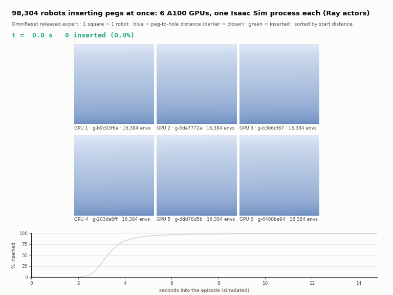

# omnireset-ray-sharded

Run Isaac Lab reinforcement learning across many GPUs with Ray. Each GPU runs its own Isaac Sim simulator as a Ray
actor; one PPO learner trains on rollouts from all of them. Example task: OmniReset peg insertion
(UR5e + Robotiq 2F-85).



## What it does

- **Faster startup.** Simulators start in parallel. Smaller simulators start faster, so splitting envs across
  simulators cuts time to the first training step.
- **One GPU, several simulators.** With NVIDIA MPS, several simulators share one GPU at full training speed.
- **More GPUs, more envs.** Add GPUs to add simulators. Each simulator has its own PhysX 64K-materials budget and
  its own host memory.
- **Restarts.** A failed simulator restarts and rejoins while training continues.
- **Fast reset data.** Ray Data converts reset states into small per-simulator files once; each simulator loads
  only its share.

## Measured (A100-80GB, PhysX TGS, 16,384 envs per GPU unless noted)

| Setup | Time to first step | Training speed |
|---|---:|---:|
| 1 GPU, 4 simulators x 4,096 envs, MPS | 3.6 min | 19.3K env-steps/s |
| 4 GPUs, 4 simulators x 4,096 envs | 2.5 min | |
| 5 GPUs, 81,920 envs | 9.4 min | 101K env-steps/s |

Scaling from 1 to 5 GPUs: 96% of linear.

## Requirements

- A Ray cluster with GPU nodes (tested on Anyscale, Ray 2.60, Python 3.12).
- Isaac Sim 6.1.0.0, Isaac Lab 3.0 (ae37b02), UWLab 2.0 (2b40afb), UW rsl_rl 5.4.1, torch 2.11 cu128.
  Build the image in `image/`:

```
cd image
python make_containerfile.py
anyscale image build -n omnireset-ray-sharded -f Containerfile.isaac
```

- Shared storage at `/mnt/cluster_storage` (change `STORAGE` in `config.py` for another path).

## Quick start

```
python check_gpus.py                 # one task per GPU: checks every GPU is reachable
python build_reset_bank.py           # reset states -> per-simulator files (Ray Data)
python scale_training.py --smoke     # 2 simulators x 1,024 envs, 3 training iterations
python teardown.py                   # stop everything, check for leftover Isaac processes
```

## Single GPU

```
python one_gpu.py --only mps --envs 16384 --k 4     # 4 simulators x 4,096 envs sharing one GPU with MPS
python one_gpu.py --only overlap --envs 16384       # next run starts while the current one trains
```

`one_gpu.py` starts the MPS daemon on the node with a Ray task and stops it at the end. Each simulator needs about
11 GB of GPU memory before envs are added; size `--k` to the GPU.

## Multiple GPUs

```
python scale_training.py --ws 1 2 4 --envs 16384    # training at 1, 2 and 4 GPUs
python learner_placement.py                         # learner on its own GPU vs sharing a simulator's GPU
python fault_tolerance.py                           # stop one simulator mid-run; it restarts and rejoins
```

## Sizing

```
python memory_sweep.py           # GPU memory and speed vs envs per simulator
python startup_and_memory.py     # host memory and physics materials vs envs per simulator
```

Measured for the peg task: about 5.5 GB host memory per simulator plus 2.1 MB per env; 2 PhysX materials per env,
so one simulator holds at most 32,767 envs.

## Settings (`config.py`)

| Setting | Meaning |
|---|---|
| `TASK`, `TASK_OVERRIDES` | Isaac Lab task id and Hydra overrides |
| `ENVS_PER_GPU` | envs per simulator |
| `NUM_WORKERS` | number of simulators |
| `ROLLOUT_LEN` | steps per rollout sent to the learner |
| `BANK_PAIR` | reset-data partition matching the task objects |
| `STORAGE`, `RESULTS_DIR`, `CKPT_DIR` | shared paths for results, reset bank and checkpoints |

## Files

| File | Purpose |
|---|---|
| `sim_worker.py` | simulator actor: Isaac Sim on its GPU, rollouts, startup timers, GPU telemetry |
| `learner.py` | PPO learner actor: updates from all simulators, success-guided sampling, checkpoints |
| `train_loop.py` | starts simulators in parallel, gathers rollouts, rejoins restarted simulators |
| `bank_pipeline.py` | Ray Data pipeline for reset states |
| `scene_patches.py` | optional scene changes, such as one shared physics material per object |
| `gpu_telemetry.py`, `common.py` | GPU sampling, result files, run cost |
| `cluster_env.py` | installs the stack on a node at runtime if the image lacks it |
| `image/` | Containerfile and pinned package list |


## Credits

Task, assets and policies: [OmniReset](https://arxiv.org/abs/2603.15789), [UWLab](https://github.com/UW-Lab/UWLab),
[uwlab-assets](https://huggingface.co/datasets/UW-Lab/uwlab-assets). Built on [Isaac Lab](https://isaac-sim.github.io/IsaacLab/)
and [Ray](https://docs.ray.io/).
