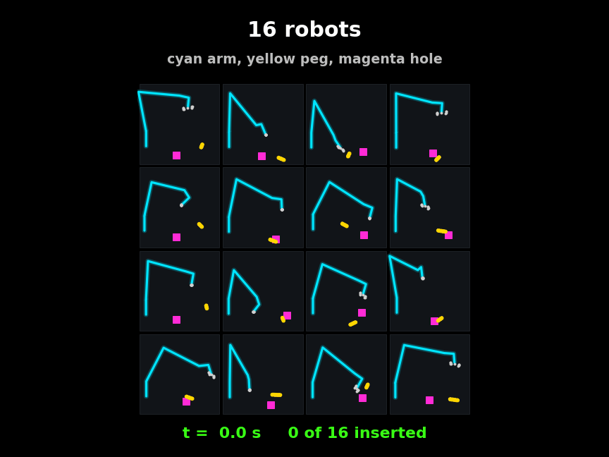
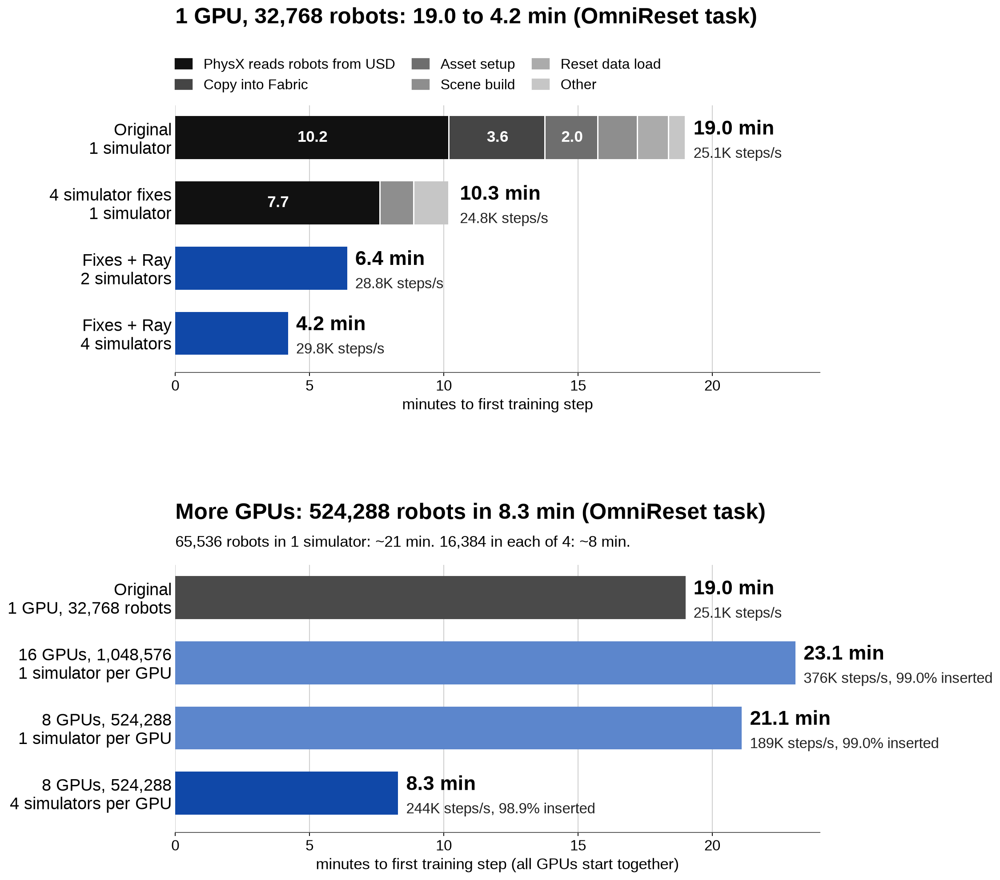
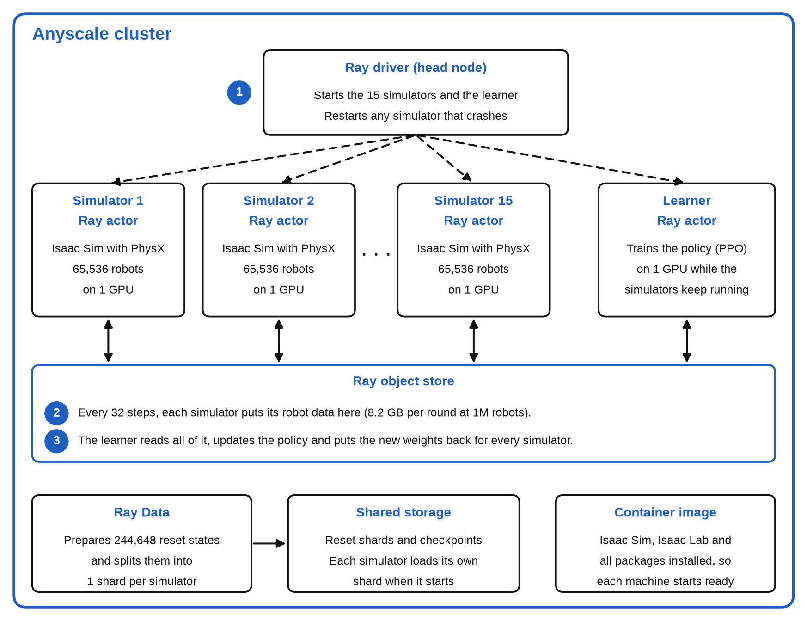
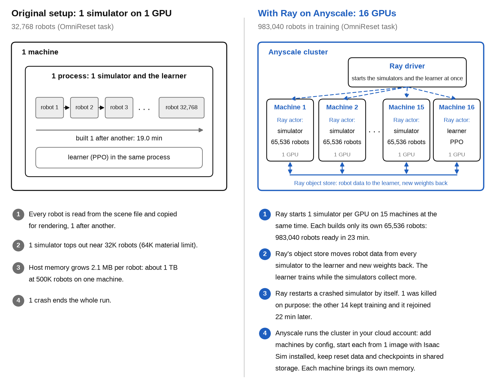
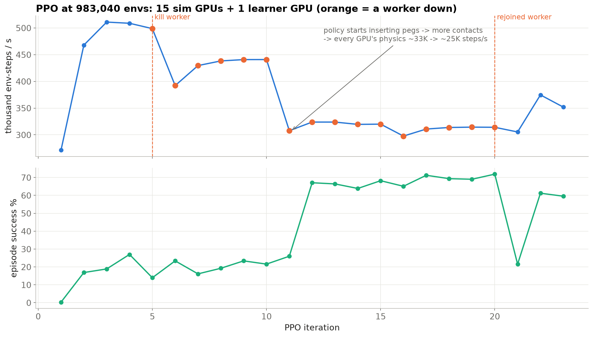
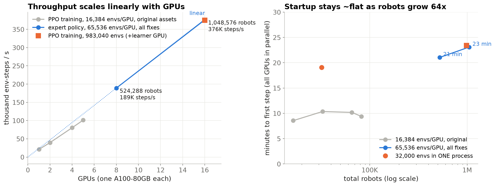
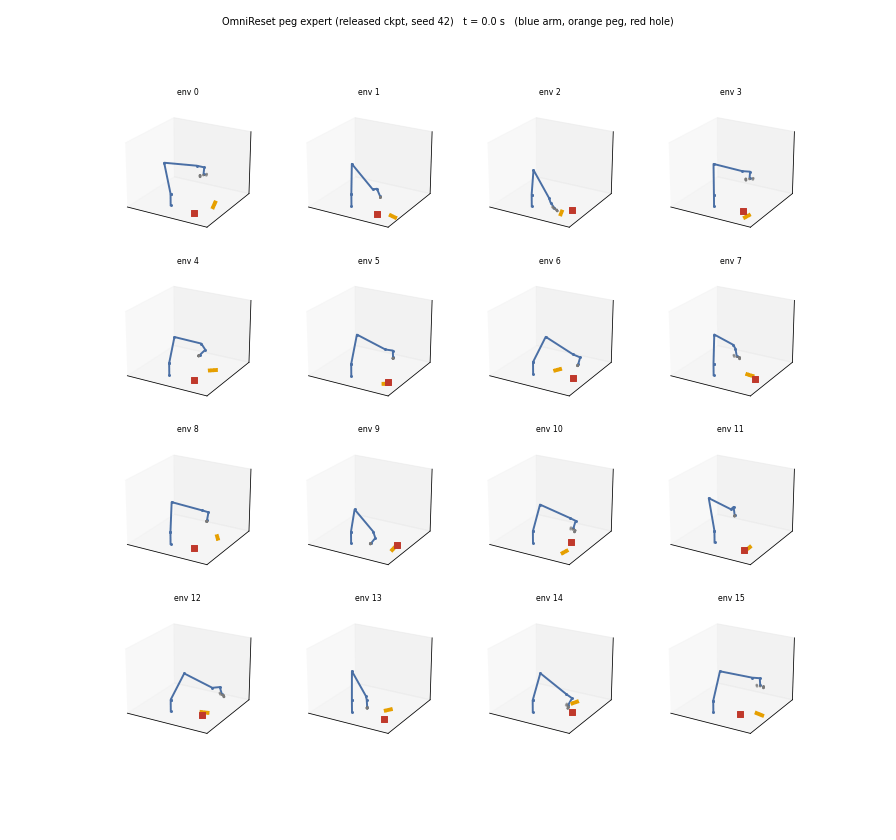

# omnireset-ray-sharded

Run Isaac Lab reinforcement learning on many GPUs with Ray: many small Isaac Sim simulators (Ray actors), all started
at once, and one PPO learner that trains on rollouts from all of them. Example task: OmniReset peg insertion
(UR5e + Robotiq 2F-85), PhysX.



## The idea in one line

Each simulator builds its robots one after another, so **startup depends on robots per simulator, not on the
total**. Keep simulators small, pack about 4 per GPU, and start all of them at the same time.



## Recommended setup

1. **Simulator fixes** (`--patch physics_only_nofabric_scaled`): faster scene reads, no Fabric copy, a third of the
   host memory, PhysX GPU buffers sized per simulator. Same physics: the released expert inserts 98.9% either way.
2. **About 16,384 robots per simulator, 4 simulators per 80 GB GPU**, sharing the GPU through NVIDIA MPS.
3. **One more GPU for the learner.** Add GPUs for more robots; startup stays about the same.

## How to run

```
python check_gpus.py          # 1 task per GPU: every GPU reachable, software installed
python build_reset_bank.py    # reset states -> 1 small file per simulator (Ray Data, ~1 min)

# smoke test: 1 GPU x 4 simulators x 1,024 robots + 1 learner GPU, 3 iterations (~3 min)
python train.py --gpus 1 --sims-per-gpu 4 --envs-per-sim 1024 --iterations 3

# training: 7 GPUs x 4 simulators x 16,384 robots = 458,752 robots + 1 learner GPU (8 GPUs in total)
python train.py --gpus 7 --sims-per-gpu 4 --envs-per-sim 16384 --iterations 200

python teardown.py            # stop everything, check for leftover Isaac processes
```

`train.py` starts and stops MPS on the machines it uses, places exactly `--sims-per-gpu` simulators on each GPU (Ray
placement group) and gives the learner its own GPU. Checkpoints: `CKPT_DIR/<tag>/`, results: `RESULTS_DIR/<tag>.json`
(`config.py`). `--resume <checkpoint>` continues from a checkpoint.

**Before a long run on a new GPU type or scene, check one GPU:**

```
python one_gpu.py --only mps --envs 65536 --k 4 --patch physics_only_nofabric_scaled   # 4 x 16,384 on 1 GPU
```

It prints startup, speed and GPU memory (measured: 7.4 min, 40.1K env-steps/s, 56 GiB). It steps with random
actions; a policy that inserts pegs makes more contacts and needs about 12 GB more on an 80 GB GPU at 65,536 robots.
Lower `--k` or `--envs` until there is room for that.

## Measured (A100-80GB)

Training, run with the commands above:

| Command | Robots | Startup | Speed |
|---|---:|---:|---:|
| `train.py --gpus 1 --sims-per-gpu 4 --envs-per-sim 1024` | 4,096 | 1.1 min | 7.3K env-steps/s |
| `train.py --gpus 7 --sims-per-gpu 4 --envs-per-sim 16384` | 458,752 | 7.8 min | 302K env-steps/s |

At 458,752 robots each PPO update uses 14.7M samples (13.4 s on the learner GPU, while the simulators collect the
next rollout). Success went from 0.3% to 17-24% in the first 10 iterations.

Startup with the released expert policy (65,536 robots per GPU):

| Per GPU | Startup | Speed | GPU memory, peak | Inserted |
|---|---:|---:|---:|---:|
| 1 simulator x 65,536 | 21.1 min | 23.8K env-steps/s | 39 GiB | 99.0% |
| 2 simulators x 32,768 | 11.9 min | 28.8K | 56 GiB | 98.9% |
| 4 simulators x 16,384 | 7.8 min | 30.5K | 76 GiB | 98.9% |
| 4 simulators x 16,384, buffers sized per simulator | 8.0 min | 30.7K | 58 GiB | 98.9% |
| 8 GPUs x 4 simulators x 16,384 = 524,288 robots | 8.3 min | 244K | 54-66 GiB | 98.9% |
| 8 GPUs x 1 simulator x 65,536 = 524,288 robots | 21.1 min | 189K | | 99.0% |

**Why size the buffers:** the task asks PhysX for GPU buffers sized for one big simulator (contact and pair tables,
2 GB collision scratch), and every simulator on the GPU reserves them in full. `physics_only_nofabric_scaled` sizes
them to each simulator's robots (with a 2x margin): 18 GB less with 4 per GPU, no overflow warnings, same success.
A heavier scene may need larger buffers: PhysX logs a warning when one is too small; then raise them
(`ref_envs` in `scene_patches.physics_only_nofabric_scaled`).

## How it works



- **Simulator** (`sim_worker.py`): a Ray actor with Isaac Sim and its own robots on a GPU or a share of one. Loads only
  its own reset-state file. Every 32 steps it puts its rollout in Ray's object store.
- **Learner** (`learner.py`): a Ray actor on its own GPU. PPO on rollouts from all simulators; new weights go back
  through the object store. Success-guided sampling of reset states across all simulators.
- **Driver** (`train_loop.py`): starts everything at once, passes references (never the data), and keeps training
  when a simulator crashes; Ray restarts it and it rejoins.

The diagrams below are from an earlier run at 983,040 robots with **1 simulator per GPU** (before the 4-per-GPU
results above): same code, 15 simulator GPUs + 1 learner GPU.







## Simulator fixes (`scene_patches.py`, `--patch`)

| Patch | What it does |
|---|---|
| `shared_object_materials` | objects share one physics material (no 32,767-robots-per-simulator cap) |
| `usda_assets` | assets as flattened `.usda` (no per-robot decompression of mesh data) |
| `physics_only_nofabric` | both + render-only meshes and materials removed + no Fabric / USD write-back |
| `physics_only_nofabric_scaled` | `physics_only_nofabric` + PhysX GPU buffers sized per simulator (recommended) |

32,768 robots in 1 simulator: 19.0 -> 10.3 min with `physics_only_nofabric`, host memory 70 -> 24 GB. PPO training
with the same seeds is bit-identical with and without it.

## Settings (`config.py`)

| Setting | Meaning |
|---|---|
| `TASK`, `TASK_OVERRIDES` | Isaac Lab task id and Hydra overrides |
| `BANK_PAIR` | reset-state partition matching the task objects |
| `ROLLOUT_LEN` | steps per rollout sent to the learner (32) |
| `STORAGE`, `RESULTS_DIR`, `CKPT_DIR` | shared paths for results, reset states and checkpoints |

## Requirements

- A Ray cluster with GPU nodes and shared storage at `/mnt/cluster_storage` (change `STORAGE` in `config.py`).
  Tested on Anyscale, Ray 2.60, Python 3.12, A100-80GB.
- Isaac Sim 6.1.0.0, Isaac Lab 3.0 (ae37b02), UWLab 2.0 (2b40afb), UW rsl_rl 5.4.1, torch 2.11 cu128, baked into an
  image so every machine starts ready:

  ```
  cd image && python make_containerfile.py
  anyscale image build -n omnireset-ray-sharded -f Containerfile.isaac
  ```

  The build installs many GB of packages and takes tens of minutes. `Containerfile.isaac` is self-contained (pinned
  package list embedded). (`cluster_env.py` installs the same stack at runtime, but expects the UWLab source staged at
  `SHARED_SRC` on shared storage.)

## Files

| File | Purpose |
|---|---|
| `train.py` | training entry point (GPUs x simulators per GPU x robots per simulator) |
| `train_loop.py` | starts simulators and learner, gathers rollouts, rejoins restarted simulators |
| `sim_worker.py` | simulator actor |
| `learner.py` | PPO learner actor, success-guided sampling, checkpoints |
| `mps.py` | start / stop NVIDIA MPS on Ray nodes |
| `scene_patches.py` | simulator fixes (above) |
| `bank_pipeline.py`, `build_reset_bank.py` | Ray Data: reset states -> per-simulator files |
| `one_gpu.py` | several simulators on one GPU: startup, speed, memory |
| `check_gpus.py`, `teardown.py` | cluster check, cleanup |
| `scale_training.py`, `fault_tolerance.py`, `learner_placement.py`, `memory_sweep.py`, `startup_and_memory.py` | scripts behind earlier measurements (1 simulator per GPU) |
| `config.py`, `common.py`, `gpu_telemetry.py`, `cluster_env.py`, `image/` | settings, result files, GPU sampling, install |



## Credits

Task, assets and policies: [OmniReset](https://arxiv.org/abs/2603.15789), [UWLab](https://github.com/UW-Lab/UWLab),
[uwlab-assets](https://huggingface.co/datasets/UW-Lab/uwlab-assets). Built on [Isaac Lab](https://isaac-sim.github.io/IsaacLab/)
and [Ray](https://docs.ray.io/).
